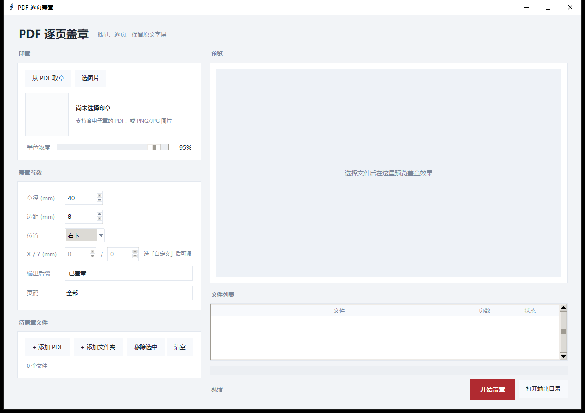

# PDF 逐页盖章工具

给 PDF 批量盖电子章的小工具：从已有 PDF 或图片里取章，自动去白底，按毫米尺寸盖到每一页的指定角落。
纯本地运行，不联网、不上传文件；盖完章的 PDF 文字层仍可选中复制。



## 功能

- **从 PDF 取章**：自动扫描页面中的红色印章，按颜色占比和形状打分选出最完整的一枚，裁掉周围白底。章上叠着的签名、中间文字会一并取出，不会只剩一个空圈。
- **也支持图片**：直接选 PNG / JPG。
- **批量处理**：可一次加多个 PDF 或整个文件夹。
- **参数可调**：章径（mm）、边距（mm）、位置（四角 + 中下 + 自定义坐标）、输出后缀、页码范围、墨色浓度。
- **保留原文件**：结果另存为 `原名-已盖章.pdf`，原文件不动。
- **保留文字层**：印章以图片层叠加，不栅格化原页面。

## 下载

不想装 Python 的话，到 [Releases](https://github.com/yeqiangdadi/pdf-stamp-tool/releases/latest) 下载 `PDFStampTool.exe`，双击即用（Windows 10/11，首次启动解包约 3-5 秒）。

## 运行

从源码运行需要 Python 3.9+。

```bash
pip install -r requirements.txt
python stamp_tool.py
```

## 打包成 exe

```bat
build.bat
```

产物在 `dist\PDFStampTool.exe`，单文件、免安装。首次运行会慢几秒（解包）。

## 参数说明

| 参数 | 默认 | 说明 |
| --- | --- | --- |
| 章径 | 40 mm | 印章宽度，高度按原图比例自动算 |
| 边距 | 8 mm | 距纸张边缘的距离 |
| 位置 | 右下 | 右下 / 中下 / 左下 / 右上 / 左上 / 自定义 |
| X / Y | 0 / 0 | 仅「自定义」时生效，单位 mm，从页面左上角量起；超出页面会自动夹回页内 |
| 输出后缀 | `-已盖章` | 输出文件名后缀 |
| 页码 | 全部 | 支持 `1-3,5`、`1,4,7-9` 这类写法 |
| 墨色浓度 | 95% | 越低越像盖淡了，一般不透明度全开反而假 |

## 实现要点

1. **去白底**：白纸扫描的印章没有真正的透明通道，用 `alpha = 255 - min(R,G,B)` 把亮度转成透明度，
   再反预乘还原颜色 `C' = (C - (255 - alpha)) / (alpha / 255)`，避免红章边缘发白。
2. **定位**：PDF 页面单位是 pt（1 mm = 72 / 25.4 pt），印章按毫米换算后铺在页面坐标系的角上，
   与纸张大小、横竖版无关。
3. **叠加**：`page.insert_image(rect, stream=png, overlay=True)`，只新增一个图像 XObject，
   同一枚章在一次保存里只嵌入一份，文件体积增长很小。
4. **保存**：`garbage=3, deflate=True` 压缩掉无用对象。

## 使用提醒

- 只对你自己有权盖章的文件使用；电子章的法律效力取决于当地规定和对方是否接受。
- 扫描件、倾斜页面上取到的章质量会差一些，预览确认后再批量跑。

## 目录结构

```
stamp_tool.py      主程序（tkinter 界面 + 图像处理 + PDF 写入）
icon.ico           应用图标
build.bat          一键打包 exe
requirements.txt   依赖
```

## 依赖

- [PyMuPDF](https://pymupdf.readthedocs.io/) — PDF 读写
- [Pillow](https://python-pillow.org/) — 图像处理
- [NumPy](https://numpy.org/) — 通道运算
